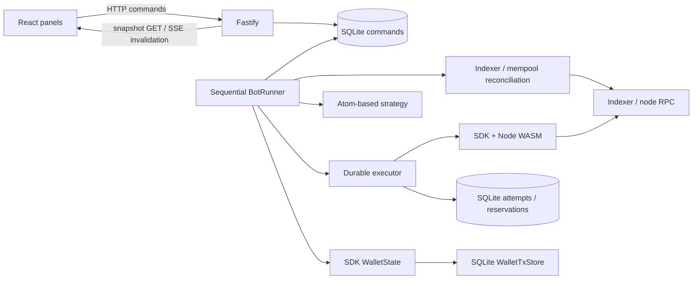

# Server architecture

One Node process owns one database/wallet runtime. All trade commands and automatic
cycles use one serialized executor. A separate SQLite owner-lock connection holds
an OS file lock for the process lifetime; main-database transactions remain short.
A killed process releases its lock automatically.

## Wallet model

`WalletState` stays in the SDK and continues deriving UTXOs from the transaction
journal. Its storage adapter writes rows to SQLite instead of rewriting a browser
JSON blob. Network observations feed `applySyncDiff`, reorg handling calls
`rollbackTo`. No independent SQL UTXO projection is maintained.

An authoritative spendable set combines confirmed indexer outputs with accepted
own mempool outputs derived by `WalletState`, excludes durable reservations, and
respects the branch depth budget. Confirmed sources are checked against actual
block metadata. Unconfirmed change is usable only with mempool visibility.
The executor first attempts the shallowest funding set and expands it only when
necessary; the SDK still performs selection, fee convergence and encoding.

## Transaction lifecycle

Intent → build → sign → atomic signed bytes + WalletTx + reservations commit →
submitting → broadcasted / unknown → confirmed / conflicted.

Preview attempts have separate idempotency keys and never reserve inputs or enter
the recovery queue. Explicit rejection of a first submission releases its inputs;
a transport failure or any ambiguous previous submission keeps them reserved.
Retries resend the same bytes. Only a confirmed conflicting input spend invalidates
a possibly submitted transaction and its dependent chain. Unsupported/missing
lookup data never constitutes proof that inputs are free.

## Control semantics

Desired running state, execution mode and versioned config are durable. Stop and
mode downgrades fence in-flight work immediately; older queued Start/Live commands
cannot override them. Applied control state and its command result commit together.
Every submit checks the current gate. Already submitted bytes remain tracked after
Stop. Automatic recovery only sends in running Live mode.

Normal market making and explicit testnet self-fill simulation share execution and
recovery. Own-order discovery scans address history and full pair pages, and keeps
settlement flags separate from market liquidity. The strategy uses atom integers
and exact price ratios, includes open-order exposure and enforces fee/depth/pending
limits. Public decimal/price numbers are display values.

## Client boundary

The browser imports no account provider or network/signing client. It uses
`/api/state`, `/api/commands`, paginated history and SSE state invalidation. SSE
reconnect always fetches an authoritative snapshot. No signing keys or signed bytes
are returned by normal DTOs. Only PUBLIC_ environment variables are exposed by Vite.

## Operational data

SQLite WAL + FULL commits, schema migration version 1, periodic checkpoint and
retention for diagnostic events/finished commands. Financial attempts, WalletTx
history and unresolved reservations do not expire. Online Backup is available as
a CLI command. Runtime logs include cycle duration, config version and pending
count; durable events include action/tx/command identifiers.

See [Readme.md](Readme.md) for runtime settings and recovery behavior, and
[PROGRESS.md](PROGRESS.md) for completed checks and remaining operational acceptance.
