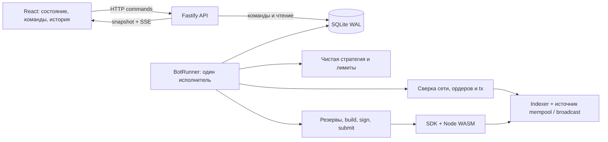

# Market Maker Bot: перенос исполнения на сервер

Дата исследования: 2026-11-12. Статус: серверная реализация и локальные проверки завершены; длительный funded testnet-прогон остаётся отдельной приёмкой (см. PROGRESS.md). Уточнение после обсуждения: сохраняем SDK WalletState и модель «журнал транзакций → UTXO»; оптимизация пересчёта допускается только после измерений.

## 1. Принятые решения

- Один сервер, один экземпляр исполнения для кошелька, SQLite. Базовый сценарий — один оператор и одна торговая пара; идентификаторы кошелька, сети и пары сохраняются во всех нужных сущностях.
- TypeScript + Node.js, Fastify для HTTP, существующий React/Vite для интерфейса. Версии Node и зависимостей фиксируются при реализации.
- Один backend-процесс: HTTP API и отдельный по ответственности модуль BotRunner. Дополнительная инфраструктура очередей и отдельный сервис БД не требуются.
- SQLite через `better-sqlite3`, явные SQL-миграции, prepared statements, WAL. Все торговые изменения проходят через последовательный исполнитель BotRunner; HTTP записывает команды и читает представления.
- Реальная Node.js WASM-сборка. Используем подход из `packages/sdk/tests/__mocks__/@mintlayer/wasm-lib.ts`: CommonJS exports из `pkg-node` + совместимый default `initWasm()` без действий. На сервере адаптер получает production-путь к Node-артефакту; сборка приложения не должна зависеть от каталога тестов. Генерируемые WASM bindings вручную не меняем.
- Кошелёк и подпись находятся на сервере. Seed/API credentials удаляются из `VITE_*`, frontend DTO и логов. Для первого варианта достаточно секрета из серверного окружения или смонтированного файла; отдельный сервис подписи не нужен.
- Рабочий market making и существующий self-fill simulator — разные режимы. Симулятор сохраняется как явно включаемый testnet-сценарий.

## 2. Результаты проверки ревью

Пути в этой таблице указаны относительно корня репозитория; номера строк относятся к состоянию на дату исследования.

| Наблюдение | Проверка и следствие |
| --- | --- |
| Цикл использует старое состояние | Подтверждено: `src/hooks/useMarketMakerBot.ts:449` внутри `setInterval` удерживает конкретный `runCycle`. Обновление callback при React render не обновляет уже установленный интервал. Устаревают `records`, `dryRun`, `broadcastEnabled`, конфигурация, offset. Новые fill-записи не попадают в поиск кандидата на conclude. |
| Видна одна страница ордеров | Подтверждено: `src/lib/orders.ts:44` запрашивает pair endpoint без pagination. SDK `getAccountOrders()` (`packages/sdk/src/mintlayer-connect-sdk.ts:3844`) фильтрует один глобальный `/order`, а не полный список ордеров аккаунта. В hook собственные ордера дополнительно пересекаются с неполной pair-страницей; fallback запускается только если глобальный ответ совсем пуст. |
| Закрытые ордера занимают выдачу | В приложении фильтрация несимметрична: `buildSyntheticBook()` отбрасывает нулевые остатки, `ownOrders` — нет; последние влияют на `maxOrders`. Но текущая официальная документация называет list endpoints списками открытых ордеров. Поведение конкретного развёрнутого indexer ещё нужно проверить; нельзя объявлять его установленным по одному коду клиента. Полностью исполненный ордер также может требовать conclude для получения накопленной ask-валюты — его нельзя просто забыть как «неактивный». |
| localStorage растёт и скрывает причину отказа | Подтверждено: `src/lib/walletStore.ts:53` хранит полный журнал и переписывает весь JSON на каждый put. Очистки/компактизации нет. Воспроизведено: ошибка записи до broadcast → `markBroadcastRejected()` не находит незаписанную tx → наружу возвращается `Transaction ... not found in wallet state`; broadcast не вызывался. Оценка «5 МБ за 4–5 часов» не измерялась. |
| Нет сверки локальных tx с сетью | Подтверждено: `WalletState.ensureFresh()` (`packages/sdk/src/wallet-state.ts:645`) только перечитывает store. Приложение не вызывает `applySyncDiff()`/`rollbackTo()`. Локальные tx остаются mempool, даже когда сеть уже подтвердила или перестала видеть их. |
| Decimals токена равны 11 | Подтверждено для simulated fill: `src/lib/strategy.ts:259` и `:280` содержат `Coin ? 11 : 11`. Метаданные decimals загружаются, но сюда не передаются. Это не утверждение, что SDK всегда использует 11 для любого токена. |

Здесь и ниже `src/...` без префикса пакета означает `examples/market-maker-bot/src/...`.

Дополнительные проблемы, существенные для длительного запуска:

1. `runCycle` возвращается без исполнения, если выключен `simulateOwnFills`. Обычный `planAllStrategyActions` сейчас служит ручным предложениям. Переезд должен включить полноценный автоматический цикл стратегии.
2. `execution.ts:166` объединяет сохранение, broadcast и запись результата в один try/catch. Таймаут отправки или ошибка сохранения после успешного broadcast трактуются как rejection. Принятая сетью tx может преждевременно потерять резервы.
3. `records` и idempotency существуют только в React memory. Перезагрузка теряет историю действий, но оставляет отдельный журнал WalletState. Отклонённый request также блокируется проверкой duplicate до явного нового ключа.
4. Ограничитель `cycleInFlightRef` не сериализует ручные операции с циклом; `Stop` не отменяет уже выполняющуюся асинхронную работу. Возможна отправка после нажатия Stop/Clear.
5. Ошибки загрузки UTXO подавляются, а локальные выходы продолжают использоваться. Все сетевые UTXO без проверки подтверждения помечаются `confirmed` и глубина сбрасывается до нуля.
6. `chooseBranch()` определён, но не вызывается исполнителем: builder получает весь `availableUtxos`. Визуализация ветвей сейчас не обеспечивает выбор ветви.
7. Денежные расчёты используют `number`; fallback orderBook трактует atoms как decimal. Даже SDK `decimalsToAtoms()` сначала вызывает `Number(value)`. Воспроизведено: строка `9007199254740993` при decimals=0 превращается в `9007199254740992`. В conclude SDK есть вычитание atoms через `parseInt`. Одной замены decimals в UI недостаточно.
8. `quoteLevelOffset` непрерывно увеличивает удалённость новых котировок; нет полноценной политики восстановления заданной сетки вокруг текущей цены.

## 3. Целевая схема



Браузер не запускает таймер торговли, не хранит журнал кошелька, не рассчитывает торговые решения и не подписывает транзакции. Закрытие вкладки, несколько открытых UI и обрыв SSE не влияют на исполнение.

Размещение в существующем workspace-пакете:

```text
examples/market-maker-bot/
  src/                      # React, API client, отображение DTO
  shared/                   # схемы команд/ответов, публичные типы
  server/
    main.ts                 # HTTP, запуск runtime, graceful shutdown
    api/                    # команды, snapshots, history, SSE, auth
    runtime/                # BotRunner, scheduler, command queue
    strategy/               # котирование, exposure, testnet simulator
    chain/                  # indexer/node adapters, reconciliation
    execution/              # tx lifecycle, reservations, retries
    persistence/            # repositories, SQL migrations, backup
    signing/                # серверный account provider, Node WASM adapter
    observability/          # structured events, logging, health
  tests/                    # engine, SQLite integration, recovery
  data/                     # runtime DB, вне git и frontend build
```

## 4. Исполнение и управление

- Последовательный async scheduler: следующий цикл планируется после завершения предыдущего. У каждого внешнего запроса есть timeout/AbortSignal; сбои получают ограниченный backoff с jitter.
- Команды от UI сохраняются с request ID и idempotency key. Ответ означает «принята», UI показывает результат применения отдельно. Ручные create/fill/conclude/prepare идут через тот же исполнитель, что стратегия.
- Сохраняем `desiredState`, `actualState`, `configVersion`, `appliedConfigVersion`. Цикл использует согласованный снимок конфигурации, перед подписью и отправкой заново проверяет актуальное разрешение исполнения.
- Вместо противоречащих друг другу флагов используем `observe`, `dry-run`, `live` плюс Start/Stop. `observe` только синхронизирует; `dry-run` строит план/preview без отправки и без постоянного резервирования; `live` исполняет.
- Stop/downgrade режима сразу закрывает шлюз новых отправок и инвалидирует неотправленные решения. Уже отправленную tx отменить этим нельзя; её сверка продолжается. Ответ команды сообщает, есть ли отправка в процессе.
- Смена пары/сети/кошелька проходит через остановку и повторную синхронизацию; прежние открытые ордера остаются видимыми и управляемыми. Изменения торговых параметров применяются с новой версией на следующем решении.
- При старте после падения сначала восстановление и reconciliation, затем разрешение стратегии. Сохраняем желаемый режим; автоматическое возобновление live возможно только после успешных проверок и при включённой серверной политике auto-resume.
- Запуск второго исполнителя с тем же файлом БД блокируется эксклюзивной process lock на локальном хосте, освобождаемой ОС при завершении. Никакого удержания SQL write transaction на время работы процесса или сетевого запроса.

## 5. Данные и SQLite

Минимальная схема, без универсального workflow-framework:

| Сущность | Назначение |
| --- | --- |
| `bot_config` / `runtime_state` | Версии настроек, режим, состояние, heartbeat, причина паузы |
| `wallet_addresses` / `token_metadata` | Идентификатор кошелька/сети, адреса, decimals и источник метаданных |
| `commands` / `actions` | Входящие команды, намерения стратегии, идемпотентность и результат |
| `transactions` / `broadcast_attempts` | Tx ID, подписанные bytes, lifecycle, причины ошибок и результаты попыток |
| `transaction_dependencies` | Родители/потомки для восстановления и пересчёта глубины |
| `wallet_transactions` / `reservations` | SQLite WalletTxStore для SDK WalletState и устойчивые резервы конкретной попытки |
| `orders` | Собственные/рыночные ордера, остатки, nonce, происхождение, незавершённые действия |
| `sync_state` / `events` | Проверенная позиция сети, история переходов, события для UI и диагностики |

- Денежные atoms храним как канонические decimal `TEXT` и обрабатываем через `bigint`; SQLite INTEGER ограничен 64 битами, а WASM Amount — u128. Цены — точная дробь или decimal-строка с явным округлением. Не сортируем atom-строки лексикографически как числа.
- Уникальность tx: `(network, wallet_id, tx_id)`. Уникальность активного резерва: `(network, wallet_id, source_type, source_id, output_index)`. Дополнительно резервируем действие над order/nonce: одного outpoint-lock недостаточно для fill/conclude.
- Применение перехода tx, изменение UTXO/резервов, запись события выполняются одной короткой SQL-транзакцией. Проверка/захват резервов — `BEGIN IMMEDIATE`, условные updates и UNIQUE constraints.
- Настройки подключения: `journal_mode=WAL`, `foreign_keys=ON`, `synchronous=FULL`, ограниченный `busy_timeout`. Подбор величин и версии SQLite фиксируется smoke-тестом установленного драйвера.
- БД хранится на локальном persistent volume. Контролируем размер DB/WAL, длительность запросов и checkpoint; SSE не держит SQL read transaction открытой. WAL допускает параллельные чтения, но у SQLite один writer. [SQLite WAL](https://sqlite.org/wal.html), [SQLite transactions](https://sqlite.org/lang_transaction.html).
- Backup через API драйвера/SQLite Online Backup; тест восстановления обязателен. Простое копирование одного открытого `.db` не является процедурой backup. [SQLite Backup API](https://sqlite.org/backup.html), [better-sqlite3 API](https://github.com/WiseLibs/better-sqlite3/blob/master/docs/api.md).

Сохраняем SDK `WalletState` как модель состояния кошелька. Реализуем его `WalletTxStore` на SQLite, а сетевые обновления передаём через существующие методы SDK. Отдельная SQL-проекция UTXO не нужна на первом этапе. Полный replay журнала сам по себе не считается проблемой: сначала измеряем время восстановления и циклов на длительной нагрузке.

История растёт на диске пропорционально действиям. UI получает ограниченные страницы, диагностические события имеют retention, логи ротируются. Рабочие транзакции и зависимости не удаляются по TTL.

## 6. Надёжный lifecycle транзакции

```text
planned → reserved → signed → submitting → mempool → confirmed
                                  └────→ unknown → сверка / повтор тех же bytes
planned/reserved → cancelled
явный окончательный отказ → rejected
доказанный внешний spend → conflicted
исчезновение из mempool / reorg → повторная проверка и восстановление
```

1. Проверить свежесть market/wallet snapshot, лимиты, состояние order/nonce и разрешение исполнения.
2. Сериализованно собрать tx через SDK на известном наборе UTXO. Перед подписью атомарно закрепить выбранные inputs и действие над order. При расхождении состояния перестроить.
3. Подписать через SDK + Node WASM; сохранить tx ID, signed bytes, inputs, dependencies и состояние `signed` до любого сетевого submit.
4. Зафиксировать `submitting` и попытку, ещё раз проверить execution gate, затем отправить. SQL-транзакцию через сетевой вызов не держать.
5. Success ответа означает принятие узлом, а подтверждение фиксируется отдельно по сети. Timeout, обрыв связи, 5xx либо ошибка БД после submit означают `unknown`; резервы сохраняются.
6. Recovery сначала ищет известный tx ID в сети и mempool. Повторная отправка использует те же signed bytes. Ответ «already known» не порождает новую tx.
7. Новая сборка с другим tx ID допускается только после разрешения судьбы старой попытки. Для unknown нет автоматического освобождения inputs по одному timeout/TTL.
8. При окончательном отказе родителя блокируются потомки; пересборка использует только заново проверенные inputs. Учитываем отдельный конфликт order/nonce и внешние траты кошелька.

Практическая гарантия: устойчивые намерения, атомарные резервы и безопасный повтор конкретной tx. Не обещаем атомарность между SQLite commit и сетью: этот разрыв закрывается состоянием unknown и сверкой.

## 7. Reconciliation и рыночные данные

- На каждом цикле сначала reconciliation активных tx/orders, затем стратегия. Подтверждение связано с реальными block height/hash конкретной tx, а не с текущим tip в момент опроса.
- Indexer даёт подтверждения, UTXO и ордера; для mempool нужен проверенный источник на стороне отправки. Вариант для непрерывного live — доступный node RPC с mempool lookup и broadcast либо эквивалентный сервис. Один `404` indexer не доказывает rejection. При отсутствии mempool visibility бот остаётся консервативным и не строит неограниченные цепочки неизвестных родителей.
- Проверяем согласованность сети/genesis, tip и lag источников. API недоступен, snapshot неполный или устарел — новые торговые действия приостанавливаются, причина видна в UI. Ошибка данных не превращается в пустой стакан или нулевой баланс.
- Собственные pending spends вычитаются из индексируемого UTXO-набора; unconfirmed outputs доступны только при принятом родителе и разрешённой политике. Подтверждение не присваивается только по факту наличия в batch-ответе.
- Граф unconfirmed строится по dependencies независимо от порядка строк SQLite. Глубина считается с учётом всех родителей, включая общие coin fee inputs. Подготовка нескольких ветвей должна давать независимые funding/fee branches, а не только несколько token outputs с общей цепочкой fee change. Точные policy-лимиты проверяются для используемого узла; 24/30 из текущего UI не считаются доказанной моделью всех mempool-ограничений.
- Полные страницы pair orders: `items`/`offset` для поддерживаемого list endpoint; cursor только там, где поддержка реально подтверждена. Дедупликация по order ID, лимит времени/страниц; незавершённый обход помечается partial. Снимок публикуется целиком после успешного обхода; сдвиг tip требует повторной проверки затронутых данных.
- Свои ордера — отдельный durable registry: созданные ботом ID, найденные при bootstrap ордера, прямой refresh по ID. Не вычисляем их только из видимой первой страницы стакана. При первичном восстановлении обнаруживаем прежние собственные ордера полным обходом доступной выдачи/истории; полностью исполненные, но ещё не concluded, тоже проверяются.
- Разделяем `active market liquidity`, `filled awaiting conclude`, `conclude pending`, `concluded`. Перед fill/conclude повторно читаем баланс/nonce. Локальное pending действие учитывается до появления его в indexer.
- Поддерживаем ML ticker по выбранной сети; нынешний pair slug жёстко использует `_TML` даже для mainnet. Token/token пары не должны молча давать пустой список.
- Decimals обязательны для каждого актива: кэшируем по `(network, token_id)`, не подставляем 0/11 при ошибке metadata. Точное округление по атомам распространяется на стратегию, preview и SDK build/sign.
- Reorg: сравнение сохранённой позиции с канонической цепью, откат затронутых confirmations/UTXO/order state, сверка mempool и повторное вычисление активного графа. При невозможности найти доверенную точку — остановка торговли и resync.

По официальным API conventions page size по умолчанию 10, максимум 100. Документация также описывает aggregated `/order/pair/{pair}/book` с cursor и признаком `truncated`; он полезен для отображения, но не заменяет registry собственных order ID. Набор возможностей проверяется на конкретном deployment. [API conventions](https://docs.mintlayer.org/docs/api/conventions/), [Order API](https://docs.mintlayer.org/docs/api/endpoints/order/).

Документированные node RPC capabilities включают проверку обычного и orphan mempool и отправку транзакции с распространением по peers. Точный контракт выбранного узла закрепляется adapter tests. [Node client / RPC methods](https://docs.mintlayer.org/docs/build/sdks/python/node/).

## 8. Стратегия, интерфейс и диагностика

Стратегия получает immutable snapshot и возвращает намерения с причинами. Поддерживает заданное число bid/ask levels, TTL/reprice threshold и cancel/requote, учитывает pending create/conclude. `maxPosition` проверяется с учётом худшего исполнения уже открытых и pending ордеров; также резервируем coin на комиссии. Не отождествляем доступный баланс UTXO с полным inventory: средства и накопленные поступления в ордерах учитываются отдельно. Отдельные лимиты на число pending tx, глубину, частоту действий и расход fee за период предотвращают бесконечные повторы.

Базовый API:

- `GET /api/state` — согласованный snapshot с revision, свежестью данных, desired/actual state и причинами паузы.
- `POST /api/commands` — Start, Stop, смена режима/config, ручные create/fill/conclude, branch preparation; request ID, ожидаемая config version и результат применения.
- `GET /api/orders`, `/api/transactions`, `/api/events` — история с keyset pagination и фильтрами.
- `GET /api/stream` — SSE событий с event ID; после reconnect догрузка пропущенного либо новый snapshot, если retention уже удалил диапазон.
- `GET /health/live`, `/health/ready` — жив ли процесс и готов ли runtime; trading-paused отображается отдельно от технической готовности.

React переиспользует существующие панели, но получает все торговые данные от сервера. Показывает stale/partial/unknown, применённую версию настроек, реальные статусы вместо только `broadcasted`, причины пропуска действия, фильтры и ограниченные страницы истории. Вместо `Clear Local State` — контролируемый resync с сохранением журнала и запретом потери unresolved tx.

Доступ к управлению требует аутентификации. Для одного оператора достаточно серверной сессии с HttpOnly cookie, same-origin API и защитой мутаций; seed, RPC credentials и raw signed bytes не возвращаются обычными DTO. Начальный deploy — localhost либо закрытый доступ; для удалённого UI HTTPS/reverse proxy.

Логи — JSON/Pino: `botId`, `cycleId`, `commandId`, `actionId`, `txId`, `orderId`, `configVersion`, `duration`, error code, причина решения. Seed, credentials и signed bytes редактируются/исключаются. Переходы состояния пишутся в SQLite как business events; диагностические логи — stdout с ротацией. [Fastify logging](https://fastify.dev/docs/latest/Reference/Logging/).

Метрики/экран состояния: heartbeat, время/результат последнего цикла и sync, indexer lag, pending/unknown age, retries, глубина ветвей, fee budget, длительность SQLite операций, размер DB/WAL, свободное место. Уведомления и отдельный monitoring stack можно подключить позже; первый релиз обязан показывать неисправность и объяснять остановку.

## 9. Порядок реализации и критерии этапов

| Этап | Работа | Проверяемый результат |
| --- | --- | --- |
| 0. Node и API contracts | Подключить предоставленную Node WASM-сборку через adapter по образцу Jest; серверный build/start. Проверить реальные pagination, order states, tx lookup, mempool/broadcast capabilities. | Отдельный Node-процесс строит и подписывает тестовую tx реальным WASM без DOM, jsdom и live-отправки. Зафиксированы supported/unsupported capabilities. |
| 1. SQLite и runtime | Миграции, repositories, сериализованный BotRunner, команды/режимы/config versions, process lock, health/shutdown. | После restart состояние и команды сохранены; второй исполнитель не запускается; Stop и смена режима действуют на текущую работу. |
| 2. Read-only sync | Полные pair pages, registry своих orders, token metadata, WalletState через SQLite store, network cursor, fresh/partial состояния. | Видны ордера за первой страницей и полностью исполненные собственные ордера; ошибки API явно останавливают решения; производительность WalletState измерена на реалистичной истории. |
| 3. Durable execution | Actions/attempts, атомарные UTXO и order reservations, signed bytes до submit, unknown/retry/recovery, dependency handling. | После принудительного падения в любой точке нет повторного намерения или преждевременно освобождённого input; accepted-but-response-lost разрешается сверкой. |
| 4. Автоматическая стратегия | Перенести расчёты на сервер, exact amounts, ограниченные ladders/reprice, exposure/fees/pending limits, ветви. Точечные изменения SDK для exact conversions/conclude и проверенных API contracts. | Обычный market making работает без simulator; decimals 0/6/8/11/18 и крупные atoms сохраняют точность; лимиты учитывают открытые и pending действия. |
| 5. UI и переход | API/SSE client, переиспользование панелей, история/фильтры, удаление browser execution/seed/localStorage. Серверные env и run scripts. | Закрытие вкладки не останавливает бота; два UI не создают два исполнителя; reconnect восстанавливает представление. |
| 6. Длительный прогон и эксплуатация | Failure tests, 24–72 часа testnet, backup/restore, log retention, supervisor/container и persistent volume, обновлённые README/ARCHITECTURE/PROGRESS. | Выполнены критерии ниже; результат прогона приложен, непройденные пункты не обозначены как готовые. |

Этапы 0–3 дают наблюдаемый и восстанавливаемый headless runtime; затем включается рабочая торговля и переключается UI. SDK меняется только по доказанным нуждам backend, без переписывания WASM encoding в TypeScript.

## 10. Проверка восстановления и длительной работы

Обязательные сценарии:

1. Сбой до/после reserve, после sign persistence, перед отправкой, после принятия сетью до HTTP-ответа и до записи результата.
2. Таймаут/429/5xx API, временная потеря indexer/node, lag и рассогласование tip, пропавшая из mempool tx, внешняя трата UTXO и reorg с повторным подтверждением.
3. Ручное действие одновременно с автоматическим; повтор HTTP-команды; Stop/dry-run во время build/sign и при заблокированном submit; restart с unresolved attempts; запрет второго worker.
4. Более 10/100 ордеров, смещающиеся страницы, закрытые и полностью filled ордера; свои ордера за пределами первой страницы; ошибочные decimals и zero-decimal активы.
5. Общий fee parent у разных token branches, достижение chain policy limit, parent rejection с потомками; depth не зависит от порядка строк в БД.
6. `SQLITE_BUSY`, ошибка записи/диск заполнен, восстановление из online backup, WAL checkpoint при активном UI, очистка диагностической истории без потери рабочего состояния.

Для release: 24–72 часа непрерывного testnet run с перезапусками и сетевыми отказами; нет двойных активных резервов и повторных заявок на одно намерение, нет застрявших tx без статуса/причины, память выходит на плато, цикл не замедляется из-за всей истории. Отдельно измеряем расход fee, размер DB/WAL и restart recovery time. Быстрый ускоренный тест покрывает недели событий; он дополняет реальный прогон, но не подменяет его.

Переход со старого клиента: остановить browser loop и дождаться завершения in-flight операций, сохранить доступные tx/order ID как подсказки, затем bootstrap сервера по сети и сверить unresolved tx. Старый localStorage не считается достоверным источником confirmations и резервов; импорт никогда сам по себе не отправляет tx. Старую и новую live-версии с одним кошельком одновременно не запускать. Rollback к старому runner — только после остановки нового и разрешения его pending attempts.

## 11. Выполненная проверка исходной базы

- TypeScript SDK: `packages/sdk/node_modules/.bin/tsc --noEmit` — успешно.
- SDK: Jest `--runInBand --silent` — 20 suites, 111 tests, 17 snapshots прошли. Указание 15 suites в AGENTS.md устарело относительно текущего дерева.
- Bot: обе проверки TypeScript и production `vite build` — успешно.
- Прямой `require` Node-сборки из `tests/__mocks__/pkg-node` работает; все 55 требуемых SDK runtime-экспортов присутствуют. Существующие standalone-provider/signing тесты используют эту реальную сборку через shim.
- Отдельные offline probes подтвердили маскирование ошибки storage write и потерю точности decimal conversion, описанные выше.
- Никакие live-транзакции при исследовании не отправлялись. Долгий testnet run ещё не выполнялся. Доступность и поведение конкретного развёрнутого indexer/RPC не проверены: публичные testnet URL не были доступны через исследовательский web-инструмент.
- Локальный launcher `pnpm --version` завершился `fetch failed`; проверки выполнены существующими локальными bin без переустановки зависимостей. Историческое сообщение PROGRESS.md о TypeScript build failure сейчас не воспроизводится.
